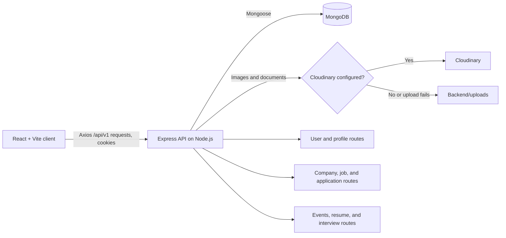

# CareerNest Job Portal

CareerNest is a job and career preparation application with separate experiences for students and recruiters. Students can browse and apply for jobs, manage their profiles and resumes, and practice interviews. Recruiters can manage companies and job postings and review applicants.

## Technology stack

| Layer | Technologies |
|---|---|
| Web client | React 18, Vite 8, React Router, Redux Toolkit, Redux Persist, Axios |
| UI | Tailwind CSS 4, Radix/shadcn-style components, Material Tailwind, Framer Motion |
| API | Node.js (ES modules), Express 5, cookie-parser, CORS |
| Database | MongoDB with Mongoose |
| Authentication | bcryptjs password hashing, JWT in an HTTP-only cookie and bearer token |
| File handling | Multer memory uploads, PDF/DOCX text extraction with `pdf-parse` and `mammoth` |
| Optional media storage | Cloudinary; local `Backend/uploads/` fallback |

The resume analysis and interview practice features run in the application code. They do not call an external AI service.

## Architecture



The frontend is in `Frontend/`; the API is in `Backend/`. The backend mounts route groups at `/api/v1/user`, `/api/v1/company`, `/api/v1/job`, `/api/v1/application`, `/api/v1/event`, `/api/v1/resume`, and `/api/v1/interview`. Mongoose models represent users, companies, jobs, applications, events, resumes, and interviews.

## Implemented features

- **Accounts and profiles:** Student/recruiter registration and login, password hashing, JWT authentication, profile updates, and student saved jobs. The API issues an HTTP-only cookie and returns a token that the frontend also stores in local storage and sends as a bearer token.
- **Job search and applications:** Browse jobs and internships, view job details, search/filter job listings, apply to jobs, and view saved or applied jobs.
- **Recruiter tools:** Register and update a company, post and manage jobs, view applicants, and update application status.
- **Events:** Browse event listings and details. Recruiter event endpoints support creating, updating, and deleting events.
- **Resume tools:** Upload PDF or Word resumes (up to 10 MB), extract document text, run an ATS-style analysis, compare content to a job description, build/save resume drafts, and request writing suggestions.
- **Interview practice:** Prepare for job-specific practice questions, schedule and manage practice sessions, save answers, and receive generated feedback.

The interview feature is a self-practice/demo workflow; it does not provide live video interviewing. Some UI areas and filters are not fully wired end-to-end, so verify the relevant workflow before relying on it in production.

## Local setup

### Requirements

- Git
- Node.js 20.19+ and npm (compatible with Vite 8 and the project dependencies)
- MongoDB running locally, or a MongoDB Atlas connection string

### 1. Get the code

```powershell
git clone https://github.com/shrrya19/Job-Portal-AWS.git
cd .\Job-Portal-AWS
```

### 2. Configure and run the backend

Create `Backend/.env` from the example. In PowerShell:

```powershell
Copy-Item .\Backend\.env.example .\Backend\.env
```

Set the values in `Backend/.env`:

```dotenv
PORT=5000
MONGO_URI=mongodb://127.0.0.1:27017/job-portal
SECRET_KEY=replace-with-a-long-random-secret
FRONTEND_URL=http://localhost:5173
BACKEND_URL=http://localhost:5000

# Optional: enable Cloudinary storage for uploaded images and documents.
CLOUD_NAME=
API_KEY=
API_SECRET=
```

Generate a signing secret instead of using the example text:

```bash
node -e "console.log(require('crypto').randomBytes(32).toString('hex'))"
```

Keep `.env` private and never commit real credentials. If Cloudinary is not configured, uploaded files are saved under `Backend/uploads/`.

Install dependencies and start the API:

```powershell
cd .\Backend
npm ci
npm run dev
```

The API listens on `http://localhost:5000`. It connects to MongoDB during startup and requires `MONGO_URI` and `SECRET_KEY`.

### 3. Run the frontend

In a second terminal:

```powershell
cd .\Frontend
npm ci
npm run dev
```

Open the Vite URL shown in the terminal (normally `http://localhost:5173`). The frontend API URLs are currently set to `http://localhost:5000` in `Frontend/src/utils/constant.js`.

### Useful checks

```powershell
# Frontend production build and lint
cd .\Frontend
npm run build
npm run lint

# Backend utility tests (ATS and interview engine)
cd ..\Backend
npm test
```

## AWS deployment

### Recommended AWS layout

- **Amazon EC2:** Run the Express API behind Nginx with HTTPS.
- **Amazon S3 + CloudFront:** Host the built Vite frontend as static assets. Keep the S3 bucket private and use CloudFront Origin Access Control (OAC).
- **MongoDB Atlas:** Create a MongoDB deployment in an AWS region near the EC2 instance and use its connection string as `MONGO_URI`. This application uses MongoDB/Mongoose; Amazon RDS is not a drop-in database replacement. If evaluating Amazon DocumentDB, first verify compatibility with the Mongoose features used by the app.
- **Uploaded files:** The current code supports Cloudinary or local disk, not S3 object storage. For an EC2 deployment, configure Cloudinary for durable uploads. To store resumes and images in S3, add and test an S3 storage adapter in the backend before enabling it; do not assume the existing upload code writes to S3.

> **Production configuration required:** All frontend API constants currently point to `http://localhost:5000`. Before building for AWS, change them to the HTTPS API origin (for example, `https://api.example.com/api/v1/...`) or refactor them to use a Vite environment variable. Otherwise, a deployed browser will try to contact the visitor's own computer instead of EC2.

### 1. Prepare MongoDB Atlas

1. Create a MongoDB Atlas cluster in an AWS region close to the application.
2. Create a database user with only the permissions the application needs.
3. Configure Atlas network access to permit the EC2 instance's outbound IP. Avoid allowing access from every IP address in production.
4. Copy the application connection string and set it as `MONGO_URI` in the backend environment. URL-encode special characters in the database password.

### 2. Launch and configure EC2

1. Launch an Ubuntu EC2 instance, restrict SSH (port 22) to your administrator IP, and allow inbound HTTPS (443). Allow HTTP (80) only if it is used for HTTPS redirection or certificate validation.
2. Install Node.js 20.19+ and Nginx. Clone the repository and configure the backend:

   ```bash
   git clone https://github.com/shrrya19/Job-Portal-AWS.git
   cd Job-Portal-AWS/Backend
   cp .env.example .env
   npm ci
   ```

3. Edit `Backend/.env` with production values:

   ```dotenv
   NODE_ENV=production
   PORT=5000
   MONGO_URI=<Atlas connection string>
   SECRET_KEY=<unique random secret>
   FRONTEND_URL=https://app.example.com
   BACKEND_URL=https://api.example.com
   COOKIE_SAME_SITE=lax
   CLOUD_NAME=<Cloudinary cloud name>
   API_KEY=<Cloudinary API key>
   API_SECRET=<Cloudinary API secret>
   ```

   Use a secret manager or protected environment file for credentials. Do not commit this file or put secrets in frontend build variables. The backend sets the authentication cookie as secure when `NODE_ENV=production`.

4. Run the API under a process manager such as PM2 and proxy it through Nginx. For example:

   ```bash
   sudo npm install --global pm2
   pm2 start index.js --name careernest-api
   pm2 save
   pm2 startup
   ```

   Run the command printed by `pm2 startup` to configure restart on boot. Save an Nginx site as `/etc/nginx/sites-available/careernest-api` for `api.example.com`:

   ```nginx
   server {
       listen 80;
       server_name api.example.com;

       location / {
           proxy_pass http://127.0.0.1:5000;
           proxy_http_version 1.1;
           proxy_set_header Host $host;
           proxy_set_header X-Real-IP $remote_addr;
           proxy_set_header X-Forwarded-For $proxy_add_x_forwarded_for;
           proxy_set_header X-Forwarded-Proto $scheme;
       }
   }
   ```

   Enable the site and reload Nginx:

   ```bash
   sudo ln -s /etc/nginx/sites-available/careernest-api /etc/nginx/sites-enabled/careernest-api
   sudo nginx -t
   sudo systemctl reload nginx
   ```

   Then install a TLS certificate (for example, with Let's Encrypt) and redirect HTTP to HTTPS. Keep port 5000 private to the instance; expose only the Nginx HTTPS endpoint.

### 3. Build and publish the frontend to S3

1. On a trusted build machine or CI runner with Node.js and AWS CLI, update all API URLs in `Frontend/src/utils/constant.js` to use the API's HTTPS origin.
2. From the repository root, build the static frontend:

   ```bash
   cd Frontend
   npm ci
   npm run build
   ```

3. Create a private S3 bucket for the frontend and configure CloudFront with that bucket as an origin using OAC. Configure the distribution's default root object as `index.html`; for React Router paths, configure CloudFront to serve `index.html` for SPA 403/404 responses.
4. Upload the Vite build output and invalidate CloudFront after subsequent releases:

   ```bash
   aws s3 sync dist/ s3://<frontend-bucket-name>/ --delete
   aws cloudfront create-invalidation --distribution-id <distribution-id> --paths "/*"
   ```

   Run the AWS CLI commands from the build/deployment environment using a narrowly scoped IAM role or deployment credentials with access only to the frontend bucket and CloudFront invalidations. Do not make the bucket public just to serve the site; CloudFront OAC can read from a private bucket.
5. Point `app.example.com` at CloudFront and `api.example.com` at the EC2/Nginx endpoint. Configure Nginx and CloudFront TLS certificates and ensure `FRONTEND_URL` exactly matches the deployed frontend origin. The frontend already sends credentialed Axios requests; keep the API CORS allowlist restricted to the frontend origin.

### 4. File storage and operational notes

- **Current implementation:** Cloudinary is used when all three Cloudinary settings are present; otherwise the backend writes files to `Backend/uploads/` and serves them under `/uploads`. A local EC2 disk is not a durable or shared upload store.
- **If S3 is required for uploads:** Implement an S3 adapter in `Backend/utils/fileStorage.js`, grant the EC2 instance role access only to the intended bucket/prefix, and configure private-object access and download authorization. The current `.env` example and code do not configure this integration.
- Keep backups for MongoDB, rotate credentials, monitor EC2/Nginx/API logs, and patch the operating system and Node dependencies regularly.
- Before going live, verify registration/login, cookie behavior over HTTPS, CORS, job and application workflows, uploads, and resume/interview features using production-like accounts.
