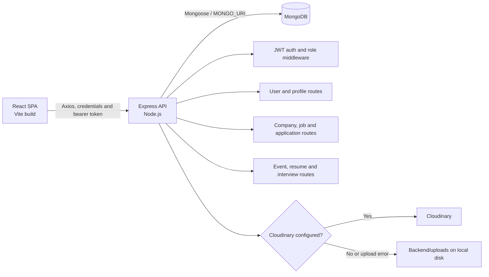
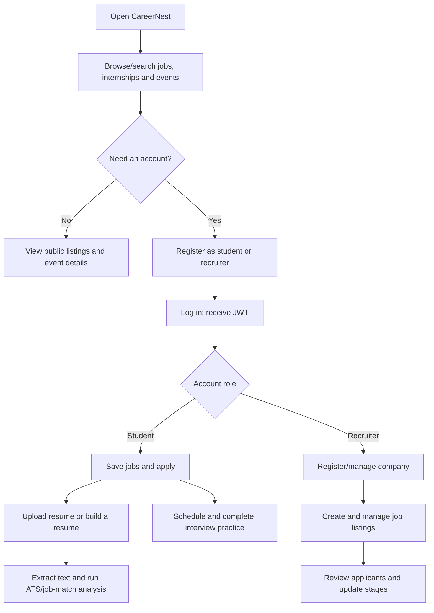
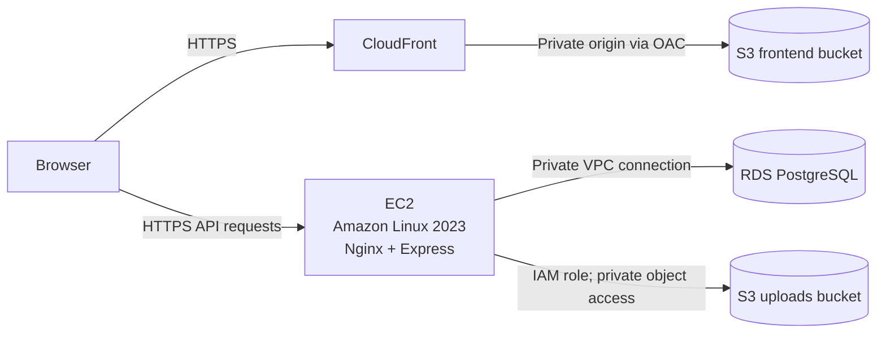

# CareerNest

CareerNest is a job-search and career-preparation web application for students and recruiters. Students can browse and apply for jobs, manage saved jobs and resumes, attend career events, and complete self-guided interview practice. Recruiters can manage companies, jobs, and applicants.

> **Deployment status:** The checked-in application currently uses MongoDB/Mongoose and Cloudinary or local disk for uploaded files. Amazon RDS is a relational database and is not compatible with the current data layer; the current upload code does not write to Amazon S3. The AWS section below explains the required code changes before using the requested EC2 + RDS + S3 architecture, and identifies a path for deploying the existing MongoDB version.

## Project details

### Features

- **Accounts:** Student and recruiter registration/login, password hashing with bcryptjs, JWT authentication, profile updates, and saved jobs. Signup passwords must start with an uppercase letter and contain at least one number and symbol.
- **Job search:** Browse jobs and internships, search listings, view job details, and apply to jobs.
- **Recruiter tools:** Register and update a company, post and manage job listings, review applicants, and update application stages.
- **Career events:** Browse events and details; recruiter event-management endpoints are present in the API.
- **Resume tools:** Upload PDF/DOC/DOCX resumes, extract text, generate heuristic ATS analysis, compare resume content with a job description, create resume drafts, and receive writing suggestions.
- **Interview practice:** Prepare for and schedule self-practice interviews, answer generated questions, save progress, and view heuristic feedback.

Resume analysis and interview prompts/feedback are generated by application code; they do not call a hosted AI model. The interview workflow is a self-practice demo, not a live video interview. Not every UI filter or event-administration view is fully wired end to end; verify any workflow you intend to use.

### Technology stack

| Layer | Technologies |
|---|---|
| Frontend | React 18, Vite 8, React Router 7, Redux Toolkit, Redux Persist, Axios |
| UI | Tailwind CSS 4, Radix/shadcn-style components, Material Tailwind, Framer Motion |
| Backend | Node.js (ES modules), Express 5 |
| Database | MongoDB with Mongoose |
| Authentication | bcryptjs password hashing, JWT, HTTP-only cookie and bearer token |
| File processing | Multer memory uploads, `pdf-parse`, Mammoth |
| File storage as implemented | Cloudinary when configured; otherwise local `Backend/uploads/` |
| AWS deployment target | EC2 (Amazon Linux 2023), RDS PostgreSQL after a database migration, S3/CloudFront after frontend configuration and an S3 upload adapter |

### Architecture (current implementation)



The frontend is in `Frontend/`; the API is in `Backend/`. The backend mounts route groups under `/api/v1`. The seven Mongoose models are `User`, `Company`, `Job`, `Application`, `Event`, `Resume`, and `Interview`.

### Main user flows



### API route groups

All paths below are relative to `/api/v1`.

| Prefix | Purpose |
|---|---|
| `/user` | Register, login/logout, update profile, save/list saved jobs |
| `/company` | Recruiter company registration, lookup, and update |
| `/job` | Public job listing/details and recruiter job CRUD |
| `/application` | Apply to a job, list applications, view applicants, update application status |
| `/event` | Public event listing/details and recruiter event operations |
| `/resume` | Resume upload/drafts/list/details/delete, analysis, job comparison, writing suggestions |
| `/interview` | Eligible jobs, preparation, schedule/list/detail, start, save answers, submit, reschedule, cancel |

### Repository layout

```text
Backend/
  controllers/     Request handlers
  middlewares/     Authentication, role checks and file upload
  models/          Mongoose schemas
  routes/          Express route definitions
  utils/           Database, file storage, parsing and analysis helpers
  uploads/         Local fallback upload directories
Frontend/
  src/components/  Pages, features, shared components and UI
  src/hooks/       Data-fetching hooks
  src/redux/       Redux store and feature slices
  src/utils/       Frontend API endpoint constants
```

## Local setup

### Requirements

- Git
- Node.js 20.19+ or 22.12+ and npm (Vite 8 requirement)
- MongoDB Community Server running locally, or a MongoDB Atlas connection string

There is no root `package.json`; install and run each package separately.

### 1. Get the code

```powershell
git clone https://github.com/shrrya19/Job-Portal-AWS.git
cd .\Job-Portal-AWS
```

### 2. Configure and run the backend

Start a local MongoDB service or create an Atlas database and database user. Then, in PowerShell:

```powershell
Copy-Item .\Backend\.env.example .\Backend\.env
```

Edit `Backend/.env` with local values:

```dotenv
PORT=5000
MONGO_URI=mongodb://127.0.0.1:27017/job-portal
SECRET_KEY=replace-with-a-long-random-secret
FRONTEND_URL=http://localhost:5173
BACKEND_URL=http://localhost:5000
COOKIE_SAME_SITE=lax

# Optional. If any Cloudinary value is omitted, uploads fall back to local disk.
CLOUD_NAME=
API_KEY=
API_SECRET=
```

Generate a signing secret:

```powershell
node -e "console.log(require('crypto').randomBytes(32).toString('hex'))"
```

Keep `.env` private; never commit credentials. For Atlas, put its connection string in `MONGO_URI` and URL-encode special characters in the database password.

```powershell
Set-Location .\Backend
npm ci
npm run dev
```

The API starts on `http://localhost:5000` after it connects to MongoDB.

### 3. Run the frontend

In another terminal, from the repository root:

```powershell
Set-Location .\Frontend
npm ci
npm run dev
```

Open the Vite URL (normally `http://localhost:5173`). The frontend API constants currently point to `http://localhost:5000`; this is suitable only for local development.

### 4. Checks

```powershell
Set-Location .\Frontend
npm run build
npm run lint

Set-Location ..\Backend
npm test
```

The backend tests cover the ATS analyzer and demo interview engine; they do not replace end-to-end tests against a live MongoDB instance.

## AWS deployment guide: EC2, RDS and S3

This section describes the requested AWS topology: Amazon Linux 2023 on EC2 for the API, Amazon RDS PostgreSQL for application data, and S3 (with CloudFront) for the frontend and, after an upload integration is added, private user files.

### Read before creating AWS resources

The topology requires application changes; AWS resource creation alone will not make the current code work with RDS or S3.

1. **RDS requires a database migration.** The app requires `MONGO_URI` and calls Mongoose APIs, uses MongoDB ObjectIds/references/population, and stores nested arrays/documents. RDS provides relational engines (such as PostgreSQL and MySQL), not MongoDB. Do not put an RDS endpoint into `MONGO_URI`: it will not work. Before using RDS, replace the Mongoose models and queries across `Backend/models/`, `Backend/controllers/`, and `Backend/utils/db.js` with a relational data layer (for example PostgreSQL with an ORM), define relational tables/relations and schema migrations, replace MongoDB-specific operations, and create/test a data migration. The current backend does not read a `DATABASE_URL`.
2. **S3 uploads require an upload adapter.** `Backend/utils/fileStorage.js` currently writes to Cloudinary or the EC2/local filesystem. It does not use S3. Add and test an S3 storage adapter, grant the EC2 instance an IAM role scoped to the intended bucket/prefix, and keep resumes private. Do not make a bucket containing resumes public. Use authenticated downloads or short-lived presigned URLs.
3. **Configure the production frontend API origin.** `Frontend/src/utils/constant.js` contains hard-coded `http://localhost:5000` endpoints. Update these to the HTTPS API URL before building, or refactor them to use a Vite environment variable and build with that variable. The current source does not read `VITE_API_BASE_URL`.
4. **Use HTTPS and matching origins.** Set backend `FRONTEND_URL` to the exact deployed frontend origin and `BACKEND_URL` to the public API origin. Use HTTPS before entering credentials. `NODE_ENV=production` enables the secure authentication cookie. If using `app.example.com` and `api.example.com`, keep them under the same registered domain and verify cookie/CORS behavior in a real browser.

#### If deploying the code without a database migration

The current app can use EC2 + **MongoDB Atlas** (put the Atlas connection string in `MONGO_URI`) + S3/CloudFront for its static frontend + Cloudinary for uploads. This is the deployment route compatible with the current source. It does **not** use RDS, and the existing upload code does **not** store files in S3. Amazon DocumentDB is not Amazon RDS; evaluate compatibility separately before using it with this Mongoose code.

For this compatible route, follow the EC2, frontend, Nginx, and verification steps below, but skip the RDS setup and SQL migration. Set `MONGO_URI=<Atlas connection string>` in the backend environment instead of `DATABASE_URL`, and add the Cloudinary credentials if uploaded files need durable storage. Do not use the example SQL environment variable or ORM migration command with the current code.

### Target architecture (after the prerequisites above)



Use separate S3 buckets for the static frontend and uploaded documents. CloudFront Origin Access Control (OAC) keeps the frontend bucket private. The uploads bucket should also block public access.

### Step 1: Check Free Tier eligibility and set a budget

1. Sign in to the AWS Console, select a single AWS Region for EC2, RDS, and S3, and open **Billing and Cost Management**.
2. Check which Free Tier plan your account is on, which services are available to it, and the eligibility labels shown in each service's create wizard. AWS account age, signup date, plan, Region, instance class, storage, and usage affect eligibility; EC2/RDS/S3 usage is not automatically free.
3. Create an AWS Budget and billing alert before provisioning. Review estimated/current charges during the setup and delete test resources when finished. Public IPv4 addresses, snapshots/backups, data transfer, CloudFront, storage, and other associated resources can incur charges.
4. Do not choose a larger instance, Multi-AZ database, paid support, or other paid configuration on the assumption that a Free Tier credit will cover it. Confirm the price/eligibility in the AWS Console and the current Free Tier terms.
5. AWS states that Free Plan accounts are for evaluation and should not process sensitive data. CareerNest handles personal details and resumes: use synthetic test data on a Free Plan, not real user information. Review the current [Free Tier terms](https://aws.amazon.com/free/terms/) before storing any personal data.

### Step 2: Complete and test the database migration

Do this before configuring the app to use RDS:

1. Choose a relational schema for the existing entities: users, companies, jobs, applications, events, resumes, and interviews. Plan how MongoDB references and nested resume/interview data will map to foreign keys and related tables or JSON columns.
2. Replace Mongoose models, populate/query/update logic, Mongo-specific indexes and ObjectIds. Update validation, unique constraints, transactions, and authorization queries as appropriate.
3. Add versioned database migrations and a repeatable migration/import script if existing MongoDB data must be retained. Test importing representative data and rolling out schema changes.
4. Change backend startup/configuration from `MONGO_URI` to the chosen SQL connection and driver. Add tests for CRUD, authentication, relationships, and the existing workflows.

Do not continue with the RDS connection step until the migrated backend works locally against the chosen SQL engine.

### Step 3: Create a private RDS database in the Console

1. In the AWS Console, open **RDS → Databases → Create database**. Choose **Standard create**, then PostgreSQL (or the engine actually supported by your migrated code).
2. Select a Free Tier-eligible template/class only if the wizard shows it for your account. For a low-cost development deployment, use Single-AZ and the smallest eligible storage/class; do not enable Multi-AZ unless you accept its price.
3. Set a unique DB instance identifier and a strong master password. Store credentials in a secure secret store or a protected server environment file; never place them in Git or frontend variables.
4. Use the same VPC as the EC2 instance. Set **Public access** to **No**. Select a DB subnet group with subnets in at least two Availability Zones, as required by RDS, while keeping database access private.
5. Create or select a database security group. Add an inbound PostgreSQL rule (TCP `5432`) whose source is the **EC2 API security group**, not `0.0.0.0/0` or an individual public client IP. Use the actual database port if another engine was selected.
6. Create the DB, wait for **Available**, then note its endpoint and port from the RDS details page. The endpoint is not a MongoDB URI. Configure the migrated backend with the SQL connection format expected by its driver/ORM (the current app has no such setting).
7. Test a database connection from EC2. Do not expose RDS publicly just to make the connection work; fix the VPC/security-group route instead.

### Step 4: Create the S3 buckets

#### Frontend bucket

1. In **Amazon S3 → Create bucket**, create a globally unique bucket name in the deployment Region.
2. Keep **Block all public access** enabled and ACLs disabled. Keep the default encryption enabled.
3. Build the production frontend after setting the API URLs:

   ```bash
   cd Frontend
   npm ci
   npm run build
   ```

4. Open the bucket in the S3 Console, choose **Upload**, and upload the *contents* of `Frontend/dist/` (including `index.html` and the `assets/` directory), not a nested `dist` folder.

#### CloudFront distribution

1. In **CloudFront → Distributions → Create distribution**, choose the S3 bucket as the origin. Use the S3 REST origin, enable Origin Access Control, and let CloudFront update the bucket policy. Do not enable S3 website hosting/public access for this private-origin setup.
2. Set the default root object to `index.html` and redirect viewers to HTTPS.
3. Because this app uses React Router, configure CloudFront custom error responses for 403 and 404 to return `/index.html` with HTTP 200, then test direct navigation/refresh on routes such as `/jobs` and `/signup`.
4. Wait for the distribution to deploy. Record its domain name. For a custom domain, add the domain and an ACM certificate in `us-east-1` to CloudFront, then configure the DNS record.
5. After each frontend release, upload the new build and invalidate the changed paths (for example, `/*`) or set appropriate cache headers/versioning.

#### Uploads bucket (only after adding the backend adapter)

Create a separate bucket for user uploads in the same Region. Keep Block Public Access enabled and default encryption on. Do not use the frontend bucket for resumes. Configure a narrowly scoped EC2 instance role to access only the required bucket/prefix and actions. Update the backend to store object keys, enforce file validation/size limits, and provide authorized access. No current code or `.env` setting enables this integration.

### Step 5: Launch an Amazon Linux 2023 EC2 instance

1. In **EC2 → Instances → Launch instances**, choose a current **Amazon Linux 2023 AMI** (not Ubuntu). Select an architecture/instance type that matches the app and is explicitly shown as eligible for your account if you need Free Tier pricing. Keep the root EBS volume small and review storage charges.
2. Create/select a key pair and securely save the private key. Use a public subnet if connecting over SSH directly; consider Systems Manager Session Manager instead where configured.
3. Create an EC2 security group:
   - SSH (TCP `22`) from **My IP** only, or do not open SSH if using Session Manager.
   - HTTP (`80`) and HTTPS (`443`) from the intended public audience for the web/API entry point.
   - Do **not** add an inbound rule for the Node API port (normally `5000`); Nginx will proxy to localhost.
4. In **IAM → Roles → Create role**, select **AWS service → EC2** as the trusted entity. Attach a custom policy limited to the uploads bucket (for example, `s3:PutObject`, `s3:GetObject`, and `s3:DeleteObject` on `arn:aws:s3:::<uploads-bucket>/uploads/*`; add only the additional permissions the adapter actually needs). Create the role, then attach it to the instance from **EC2 → Instances → select instance → Actions → Security → Modify IAM role**. Do not put AWS access keys in `.env`, source code, or the instance.
5. Launch the instance in the same VPC as RDS. Associate a stable address/DNS name if needed and check any associated public IPv4 costs.

### Step 6: Install the API on Amazon Linux 2023

Connect using EC2 Instance Connect, Session Manager, or SSH with the key pair. The following commands assume the default `ec2-user` account:

```bash
sudo dnf update -y
sudo dnf install -y git nginx

# Install a supported Node.js LTS (Vite 8 needs Node 20.19+ or 22.12+).
curl -o- https://raw.githubusercontent.com/nvm-sh/nvm/v0.40.3/install.sh | bash
source ~/.bashrc
nvm install 22
nvm use 22
node --version
npm --version

git clone https://github.com/shrrya19/Job-Portal-AWS.git
cd Job-Portal-AWS/Backend
npm ci
```

Deploy the migrated backend code and its SQL migrations before setting the production database connection. Configure `Backend/.env` on the instance (for example with `nano Backend/.env`) and restrict access to it:

```dotenv
NODE_ENV=production
PORT=5000
# Set the SQL connection variable required by the migrated backend.
DATABASE_URL=<private RDS connection string expected by the app>
SECRET_KEY=<unique random secret>
FRONTEND_URL=https://app.example.com
BACKEND_URL=https://api.example.com
COOKIE_SAME_SITE=lax
```

`DATABASE_URL` above is an example placeholder for the **migrated** application; it is not currently read by this repository. Do not deploy the current Mongoose code with this configuration. Set the real SQL variable and credentials required by the ORM/driver you implement.

Run the database migrations with the production command for the ORM selected during migration, then start the app under a process manager:

```bash
# Run your ORM's production migration command here.
npm install --global pm2
pm2 start index.js --name careernest-api
pm2 save
pm2 startup systemd
```

Run the exact command printed by `pm2 startup` to enable restart on reboot. Verify the app is listening locally before configuring the proxy.

### Step 7: Configure Nginx and HTTPS for the API

Create `/etc/nginx/conf.d/careernest-api.conf`:

```nginx
server {
    listen 80;
    server_name api.example.com;

    location / {
        proxy_pass http://127.0.0.1:5000;
        proxy_http_version 1.1;
        proxy_set_header Host $host;
        proxy_set_header X-Real-IP $remote_addr;
        proxy_set_header X-Forwarded-For $proxy_add_x_forwarded_for;
        proxy_set_header X-Forwarded-Proto $scheme;
    }
}
```

Then enable and test Nginx:

```bash
sudo nginx -t
sudo systemctl enable --now nginx
sudo systemctl reload nginx
```

Point `api.example.com` to the instance's stable public address and configure a valid TLS certificate for the API (for example, use a certificate from a supported ACME/Let's Encrypt setup on the instance, or put a correctly configured HTTPS proxy/CDN in front of it). Do not send login credentials over plain HTTP. Once HTTPS is active, confirm that the certificate covers the API hostname and that the browser's API requests use that HTTPS hostname.

### Step 8: Configure and publish the frontend

1. In `Frontend/src/utils/constant.js`, replace each `http://localhost:5000/api/v1/...` endpoint with the production API base and matching route prefix, for example `https://api.example.com/api/v1/user`. Alternatively, implement a shared Vite environment variable and build with the production value. Do not put secrets in Vite variables; anything embedded in the frontend build is public.
2. Set backend `FRONTEND_URL` to exactly the deployed origin (for example `https://app.example.com`, without a trailing path). The backend allows credentialed CORS only for origins listed there, plus its localhost development origins.
3. Build and upload `Frontend/dist/` to the private S3 frontend bucket as described above. Attach a custom domain to CloudFront if desired and point DNS to the distribution.
4. Keep frontend and API on HTTPS and preferably use subdomains of the same registrable domain (for example, `app.example.com` and `api.example.com`). Verify login cookies and bearer-token requests in a browser. Do not loosen CORS to `*` when credentials are enabled.

### Step 9: Production verification and operations

- Test signup/login/logout, student/recruiter access, job listing/application, recruiter job management, resume upload and authorized access, events, and interview practice.
- Confirm requests reach the production API, CORS uses the expected origin, the cookie is secure over HTTPS, and the EC2 API port is not publicly open.
- Confirm RDS is private and reachable only from the EC2 security group. Verify database backups and restore procedures.
- Confirm the S3 frontend bucket and uploads bucket are not public. Test direct frontend route refreshes through CloudFront.
- Configure OS/application updates, log monitoring, error alerts, credential rotation, and backups. Monitor the AWS Billing console and delete unused resources.

### Official AWS references

- [AWS Free Tier](https://aws.amazon.com/free/) and [Free Tier terms](https://aws.amazon.com/free/terms/)
- [Launch an EC2 instance](https://docs.aws.amazon.com/AWSEC2/latest/UserGuide/ec2-launch-instance-wizard.html)
- [Amazon Linux 2023 User Guide](https://docs.aws.amazon.com/linux/al2023/ug/)
- [Getting started with Amazon RDS](https://docs.aws.amazon.com/AmazonRDS/latest/UserGuide/CHAP_GettingStarted.html)
- [S3 static website hosting](https://docs.aws.amazon.com/AmazonS3/latest/userguide/WebsiteHosting.html)
- [Restrict access to an S3 origin with CloudFront OAC](https://docs.aws.amazon.com/AmazonCloudFront/latest/DeveloperGuide/private-content-restricting-access-to-s3.html)
